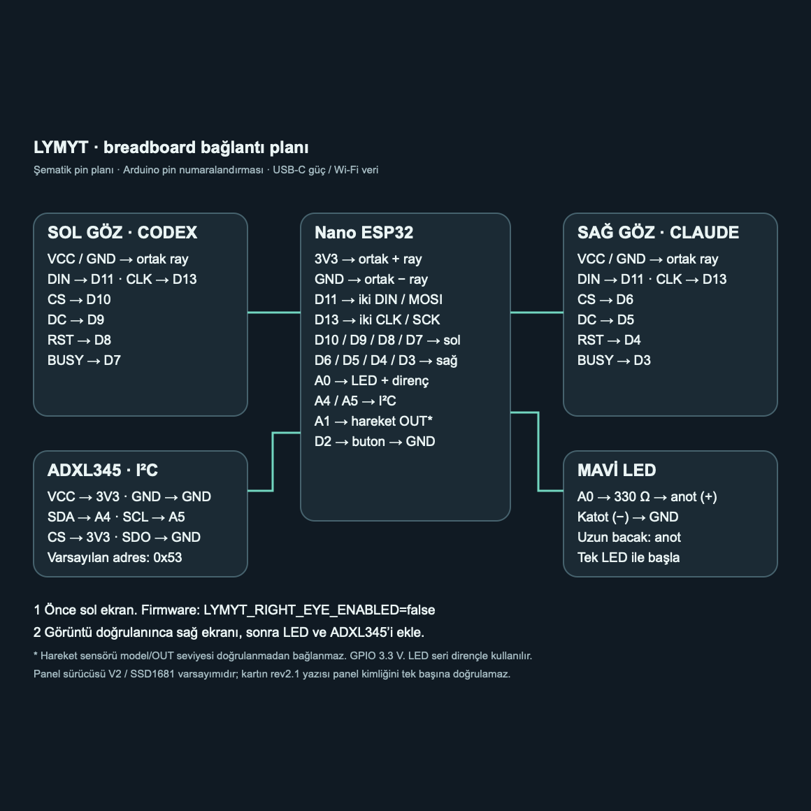

# Lymyt’i gerçek devrede kurma

Bu rehber iki Waveshare siyah-beyaz 1.54″ ekran, Arduino Nano ESP32, tek 5 mm mavi LED ve ADXL345 için hazırlanmıştır. Hareket sensörünün modeli bilinmediğinden onun beslemesi ayrı doğrulanacak. Önce masa üzerinde çalıştır; kasayı çalışan breadboard düzeninden sonra tasarla.

## 1. Masaya koyacağın parçalar

- Arduino Nano ESP32 ve **veri aktarabilen** USB-C kablo.
- İki Waveshare SPI e-paper **modül** ve bağlantı kabloları.
- Breadboard, jumper kablolar.
- Bir mavi LED ve bir **330 Ω direnç**. 220 Ω–1 kΩ arası seri direnç de başlangıç için kullanılabilir; parlaklık değişir. Diyot seri akım sınırlama direncinin yerine geçmez.
- ADXL345; varsa anlık buton. Hareket sensörü sonraki aşamada.

Güç varken kablo değiştirme. Nano’nun GPIO sinyalleri 3.3 V’tur. Modül üzerindeki pin isimlerini esas al; kablo rengine göre karar verme. Nano’yu breadboard’un orta kanalına yerleştir; iki taraftaki pinler birbirine kısa devre olmasın.

Numaralı delikleri izlemek için **[üç aşamalı breadboard rehberini](BREADBOARD.md)** kullan. Bu çizimler güç rayları yerine 22. sıranın a–e kısmını **3V3**, 23. sıranın a–e kısmını **GND** olarak kullanır. Aşağıdaki tablolarda “ray” denilen besleme hatları bu iki sıra olabilir. Uzun kenar güç raylarını kullanmayı seçersen bazı kartlarda ortadan kesik olduklarını kontrol et. USB/VBUS/5V hattını e-paper sinyal pinlerine bağlama.



## 2. Önce tek gözü bağla

Modülde VCC, GND, DIN, CLK, CS, DC, RST, BUSY pinlerini bul. İki ekranın ortak bağlantıları yalnızca besleme, GND, DIN ve CLK olacak; CS/DC/RST/BUSY ayrı tutulacak.

| E-paper pin adı | Sol göz / Codex | Sağ göz / Claude — sonra |
|---|---|---|
| VCC | 3V3 rayı | 3V3 rayı |
| GND | GND rayı | GND rayı |
| DIN / MOSI | Nano D11 | Aynı D11 hattı |
| CLK / SCK | Nano D13 | Aynı D13 hattı |
| CS | Nano D10 | Nano D6 |
| DC | Nano D9 | Nano D5 |
| RST | Nano D8 | Nano D4 |
| BUSY | Nano D7 | Nano D3 |

İlk testte **sadece sol ekranı** bağla. Kart rev2.1 yazısı panel sürücüsünü kesinleştirmez. Firmware şimdilik Waveshare V2/SSD1681 için `GxEPD2_154_D67` kullanır. V2/panel işaretini doğrula; emin değilsen [Waveshare’ın doğru panel için tek ekran örneğini](https://www.waveshare.com/wiki/1.54inch_e-Paper_Module_Manual) çalıştır. Görüntü gelmiyorsa rastgele sürücüleri art arda denemeden kimliği belirle.

## 3. Mac yardımcısını yerel Wi-Fi’a aç

Terminalde proje klasörüne gir:

```sh
cd /Users/baris/Documents/GitHub/Lymyt
python3 bridge/lymyt.py serve --host 0.0.0.0
```

8787 portunda önceki yardımcı hâlâ çalışıyorsa onun terminalinde Ctrl+C ile durdur. `Address already in use` aynı portta iki yardımcı başlatıldığı anlamına gelir.

Mac ve Nano aynı yerel ağa bağlanacak. Mac Sistem Ayarları → Wi-Fi → bağlı ağ → Ayrıntılar → TCP/IP bölümündeki yerel IPv4 adresini al; örnek `192.168.1.25`. Nano Wi-Fi için 2.4 GHz ağı kullanır. Misafir ağındaki cihaz izolasyonu Mac’e erişimi engelleyebilir.

Cihaz okuma anahtarı proje altındaki `.lymyt/device-token` dosyasında. Yalnızca kendi firmware’ine ve Lymyt Studio bağlantı alanına gir; Git’e koyma. Mac güvenlik duvarı Python’a yerel ağ erişimi sorarsa izin ver. Mac açık ve uyanık olmalı; yerel yardımcı uyuyan bilgisayardan limit okuyamaz.

## 4. Arduino IDE’de yükle

1. Arduino IDE 2’yi aç. Boards Manager’da **Arduino ESP32 Boards** paketini kur; kartı **Arduino Nano ESP32** seç.
2. Tools → Pin Numbering → **By Arduino pin** seç. Rehberdeki D11, ESP32 GPIO11 anlamına gelmez.
3. Library Manager’dan GxEPD2, Adafruit GFX Library ve **ArduinoJson 7** kur. ADXL345 aşaması için Adafruit ADXL345 ve Adafruit Unified Sensor de gerekir. Doğrulanmış sürümler [HARDWARE.md](HARDWARE.md) içinde.
4. `firmware/Lymyt/Lymyt.ino` dosyasını aç. Aynı klasörde `config.example.h` kopyasını **config.h** adıyla kaydet.
5. İlk test için aşağıdaki ayarları düzenle. SSID/şifreyi kendi ağınla, adresi Mac’in IP’siyle ve anahtarı kendi dosyandaki değerle değiştir.

```cpp
#define LYMYT_WIFI_SSID "2.4GHz-ag-adin"
#define LYMYT_WIFI_PASSWORD "ag-sifren"
#define LYMYT_BRIDGE_URL "http://192.168.1.25:8787/v1/status"
#define LYMYT_DEVICE_TOKEN "kendi-device-token-degerin"
#define LYMYT_PANEL_CLASS GxEPD2_154_D67
#define LYMYT_RIGHT_EYE_ENABLED false
#define LYMYT_PARTIAL_REFRESH false
#define LYMYT_LED_PIN -1
#define LYMYT_BUTTON_PIN -1
#define LYMYT_USE_ADXL345 false
#define LYMYT_MOTION_PIN -1
```

6. USB-C kablosunu bağla, Tools → Port’tan Nano’yu seç. Önce Verify, sonra Upload. Kartın portu görünmüyorsa veri kablosunu kontrol et; gerekirse RESET’e iki kez basıp bootloader portunu yeniden seç.
7. Serial Monitor’ü **115200 baud** aç. İlk tam yenilemede ekranın siyah-beyaz geçiş yapması normaldir. Sol gözde CODEX, kapasite ve geri sayım görünmeli. Veri yoksa nötr göz gösterilir; bu ekranın bozuk olduğunu tek başına kanıtlamaz.

Ekran varsayılan **3 dakikada bir** yenilenir. Wi-Fi verisi 15 saniyede bir okunur. Hızlı video animasyonu bu panelin hedefi değildir. İlk kurulumda kısmi yenilemeyi açma.

## 5. İkinci gözü ekle

USB gücünü çıkar. Sağ ekranı tablodaki pinlerle bağla. `LYMYT_RIGHT_EYE_ENABLED true` yapıp tekrar yükle. Sağ göz CLAUDE gösterir. Gerçek Claude verisi gelene kadar VERI YOK/nötr göz beklenir.

Bu Mac’te Claude Code status line aktarımı ayarlandı. Yeni bir Claude Code oturumunda normal bir yanıt geldikten sonra limit alanları aktarılabilir. Pro/Max hesabında sağlayıcının alanları göndermesi gerekir. Studio’da veri yoksa `.lymyt/claude.json` oluşup oluşmadığını ve Claude status line ayarını kontrol et. Eksik veri %0 kullanım kabul edilmez.

## 6. Mavi LED’i ekle

Gücü çıkar. **A0 → 330 Ω direnç → LED uzun bacak (anot)**, LED kısa bacak/flat kenar (katot) → GND. Direnç LED’in diğer tarafında da olabilir; seri olması gerekir. `LYMYT_LED_PIN A0` yapıp yükle.

Köprü bağlantısı başarılıyken LED yanar. Sallama/hareket kısa yanıp sönme oluşturur. Dolu limitin yeni pencereye geçtiği gerçek veride doğrulanırsa 12 saniye kutlama yanıp sönmesi olur. Çok sayıda LED’i bir GPIO’ya paralel bağlama; ışık grubu için transistör/MOSFET ve LED başına direnç gerekir. İlk prototip tek LED ile doğrulanacak.

## 7. ADXL345’i bağla

| ADXL345 | Nano / ray |
|---|---|
| VCC | 3V3 |
| GND | GND |
| SDA | A4 |
| SCL | A5 |
| CS — modülde varsa | 3V3; I²C seçimi |
| SDO — modülde varsa | GND; adres 0x53 |

Kartının baskısını esas al. `LYMYT_USE_ADXL345 true`, `LYMYT_ADXL_ADDRESS 0x53` seç; kütüphaneler kurulu olsun. Modül alternatif adres için ayarlanmışsa adres 0x1D olabilir.

Önce sensörü sabit bırak: toplam ivme yaklaşık 9.8 m/s² olmalı. Kasayı nazikçe eğdiğinde bir sonraki ekran yenilemesinde bakış kayar. Kısa sallama LED tepkisi verir; aynı tepkinin peş peşe tetiklenmesini sınırlayan 5 saniyelik bekleme var. Eksen yönünü kasaya göre sonradan kalibre edeceğiz. Cihaz Studio’ya bağlandığında X/Y/Z telemetrisi gönderir.

## 8. Hareket sensörü ve buton

Sensörün modelini ve OUT voltajını bilmeden besleme bağlama. Bazı PIR kartları 5 V besleme ister fakat OUT 3.3 V üretir; başka modüllerde farklı olabilir. Model doğrulandıktan sonra OUT 3.3 V uyumluysa A1’e, GND ortak raya bağlanır; besleme modül şartına göre seçilir. `LYMYT_MOTION_PIN A1` ile HIGH hareket sayılır. Başlangıç ısınma süresini modülün dokümanından kontrol et.

Yeni hareket LED tepkisi verir. 5 dakika hareket görülmezse gözler bir sonraki yenilemede uyku ifadesine geçer. PIR hareketsiz oturan kişiyi sürekli algılamayabilir.

İsteğe bağlı anlık buton: **D2 → buton → GND**, `LYMYT_BUTTON_PIN D2`. Dahili pull-up kullanılır. Kısa/haftalık görünümü değiştirir; ekrana bir sonraki yenilemede yansır. Dört bacaklı butonun aynı taraftaki bağlı bacaklarını kontrol et; butonu breadboard’un orta kanalı üstüne koy.

## 9. Mac yerine internet üzerinden çalışma

Donanımı önce LAN’da doğrula. VPS yayını, Cloudflare ve gerçek veri yüklemesi tamamlanınca `LYMYT_BRIDGE_URL` değerini `https://tezatlas.info/v1/status` yap. Bu aşamada **VPS’in device-token** değeri kullanılır; Mac’in yerel anahtarıyla aynı olması gerekmez.

`LYMYT_ROOT_CA` alanına sitenin **gerçek sertifika zincirinin güvenilir kök CA** PEM’i konur. Cloudflare Origin CA sertifikası Nano için bu alan değildir; Nano Cloudflare’ın ziyaretçiye sunduğu sertifikayı görür. Kök sertifikayı yayından sonra doğrulayacağız. Firmware HTTPS için NTP ile sistem saatini eşitler; NTP/UDP 123 ağda engelliyse TLS bağlantısı başlayamaz. Sertifika doğrulaması kapatılmaz.

Nano internete doğrudan Wi-Fi ile erişir; Codex/Claude hesap verisini Mac yardımcısı HTTPS üzerinden VPS’e gönderir. Mac uyuyunca son değer ve geri sayım korunur, ancak veri eski olarak işaretlenir. Domain bu veri kaynağını bilgisayardan bağımsız hâle getirmez.

## 10. Bir şey çalışmazsa

| Belirti | İlk kontrol |
|---|---|
| Yükleme/port yok | Veri USB kablosu, doğru kart/port, iki kez RESET |
| Ekran beyaz veya BUSY timeout | 3V3/GND, doğru BUSY/RST/CS, panel sürücüsü, tek ekran testi |
| Bir göz yanlış güncelleniyor | İki gözün CS/DC/RST/BUSY hatlarının ayrı olması |
| Gözde VERI YOK | Yardımcı çalışıyor mu, doğru IP/token, sağlayıcıdan veri geldi mi |
| LAN bağlantısı yok | 2.4 GHz, aynı ağ, guest isolation, Mac uyku/güvenlik duvarı |
| HTTPS bağlantısı yok | Domain/TLS, gerçek kök CA, sistem saati/NTP, VPS anahtarı |
| LED yanmıyor | Polarite, seri direnç, A0 ayarı, başarılı veri bağlantısı |
| ADXL verisi yok | SDA/SCL, CS/SDO seçimi, 0x53/0x1D, kütüphaneler |
| Sensörlü sürüm sürekli uyuyor | PIR ısınması, OUT seviyesi, model, doğru A1 ayarı |

Firmware’in derlenmesi doğrulandı; bu rehberdeki kablolama henüz gerçek cihaz üzerinde uygulanıp ölçülmedi. İlk tek ekran çıktısını gördükten sonra panel, sensör eşikleri ve kasa yerleşimini kesinleştireceğiz.
