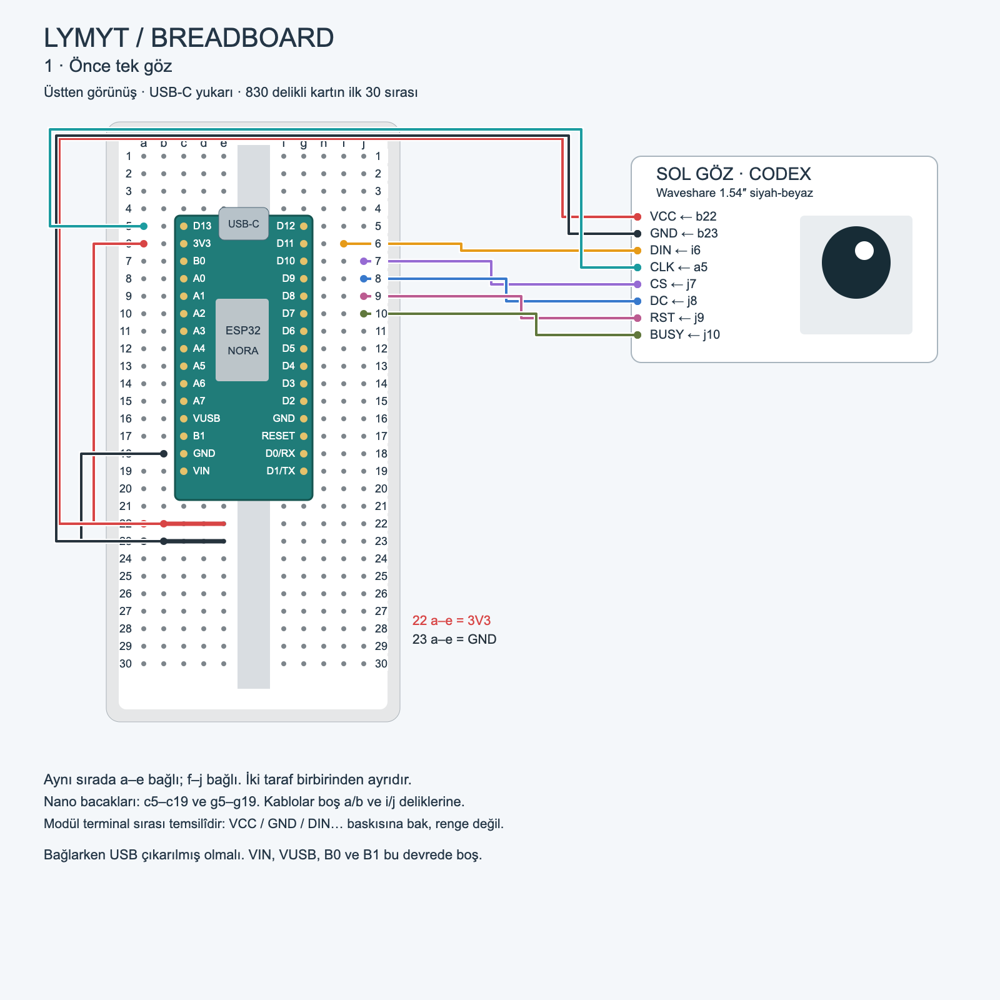
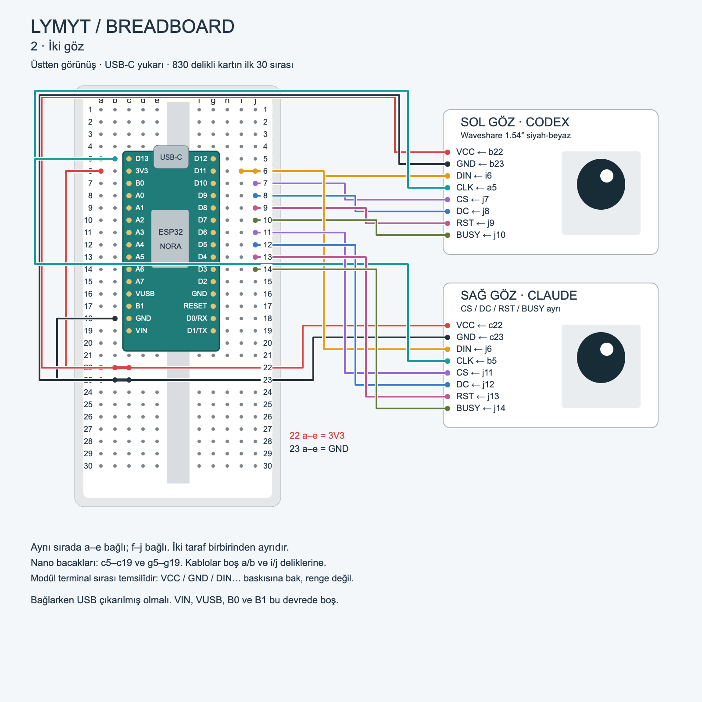
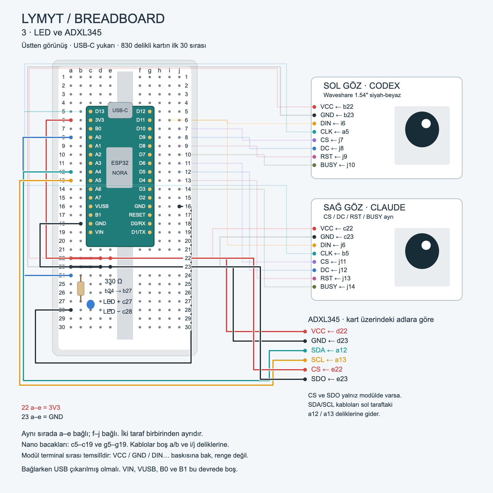

# Lymyt: delik delik breadboard kurulumu

Çizimler **830 delikli, a–j sütunları olan standart breadboard'un ilk 30 sırası** için hazırlanmıştır. Aynı sütun aralıklarına sahip 400 delikli kartta da bu bölüm sığar. Kartındaki baskı ters yöndeyse bu koordinatları kopyalamadan yönü eşleştir. Nano ESP32'nin aşağı doğru erkek pinleri takılı/lehimli olmalıdır; gevşek header elektrik bağlantısı sağlamaz. E-paper modülleri ve ADXL345 breadboard dışında durur; modül header'ına uygun dişi–erkek jumper kullanılır.

## Kartı yerleştir

**Önce header bağlantısını kontrol et:** Nano'nun iki sıra 15 pini kartın metal deliklerine lehimli olmalıdır. Pinleri breadboard'a takıp Nano'yu üstlerine oturtmak yeterli değildir. USB üzerinden kartın çalışması bu bağlantıyı doğrulamaz. Harici LED ve ekranlar birlikte tepki vermiyorsa [header kontrolü ve tek ekran tanılaması](PANEL-CHECK.md#fotoğrafta-şüphe-edilen-header-teması) ile başla.

USB-C **yukarıda**, bileşenler sana bakacak. Nano'nun sol 15 pini **c5–c19**, sağ 15 pini **g5–g19** deliklerine girer. Sol üst D13=c5, sol ikinci 3V3=c6; sağ üst D12=g5, sağ ikinci D11=g6. Orta boşluğu e/f arasında bırak. c–g pin sırası arası 0.6″ (15.24 mm); pinleri zorlayıp eğme. Kablolar solda a/b, sağda h/i/j boş deliklerine takılır.

**a–e aynı numaralı sırada birbirine bağlıdır. f–j de kendi arasında bağlıdır.** Örneğin j7, g7'deki D10 ile bağlantılıdır; a7 ile bağlantılı değildir. Yan yana farklı numaralı sıralar birbirine bağlı değildir. Çizgilerin görsel kesişmesi bağlantı anlamına gelmez; yalnız belirtilen uçlar bağlanır.

## 1. Besleme ve tek göz

USB çıkarılmışken:

1. **a6 → a22** jumper: Nano 3V3 çıkışını 22. sıranın a–e kısmına taşır.
2. **b18 → a23** jumper: Nano GND'yi 23. sıranın a–e kısmına taşır.
3. Sol ekranı aşağıdaki tabloyla bağla. 22/23. sıranın f–j tarafını besleme olarak kullanma: orta kanal üzerinden bağlantı yoktur.

Bu düzen uzun kenar güç raylarını kullanmaz. Çizimdeki 22/23 üzerindeki yatay renkli çizgiler breadboard'un iç bağlantısını gösterir; ekstra jumper değildir.

| Modül üzerindeki ad | Sol/Codex: kablonun breadboard ucu | Nano karşılığı | Sağ/Claude: sonra |
|---|---|---|---|
| VCC | b22 | 3V3 | c22 |
| GND | b23 | GND | c23 |
| DIN / MOSI | i6 | D11 | j6 |
| CLK / SCK | a5 | D13 | b5 |
| CS | j7 | D10 | j11 → D6 |
| DC | j8 | D9 | j12 → D5 |
| RST | j9 | D8 | j13 → D4 |
| BUSY | j10 | D7 | j14 → D3 |

Modül çizimindeki VCC/GND/DIN… terminal sırası bir etiket listesidir; **modülündeki fiziksel pin sırasının kopyası değildir**. Her kabloyu baskıdaki adıyla eşleştir. Panel rev2.1 bilgisi tek başına sürücüyü kesinleştirmez; ilk testte yalnız sol ekran ve doğru panel sürücüsü kullanılır.

USB takmadan önce multimetrenin süreklilik moduyla c6–a22 ve c18–a23 bağlantısını doğrula. 22 ve 23 arasında doğrudan kısa devre olmamalı. Güç verince GND'ye göre 22. sıra yaklaşık 3.3 V olmalı. Kablo değiştirirken USB'yi çıkar.

[ASSEMBLY.md, Arduino yükleme bölümü](ASSEMBLY.md#4-arduino-idede-yükle) ayarlarıyla `LYMYT_RIGHT_EYE_ENABLED false` kullan. İlk ekran testi başarılı olduktan sonra ikinci aşamaya geç.

## 2. Sağ gözü ekle

Gücü çıkar; tablonun sağ sütunundaki sekiz bağlantıyı yap. Sol göz bağlı kalır. i6/j6 aynı D11 hattıdır; a5/b5 aynı D13 hattıdır. Kontrol pinleri ayrı sıralara gider. `LYMYT_RIGHT_EYE_ENABLED true` yapıp yükle.

## 3. LED ve ADXL345

Üçüncü çizimde önceki ekran kabloları soluk gösterildi; bağlı kalırlar.

LED'in seri bağlantısı:

1. **a8 → a24** jumper (A0).
2. **330 Ω direnç** b24 ile b27 arasına; aynı sıraya iki bacağını takma.
3. LED uzun bacak/anot **c27**, kısa bacak/katot **c28**. a–e/27, direncin b27 ucu ile anot c27'yi birleştirir.
4. **a28 → j16** jumper; j16 Nano'nun sağ GND pinine bağlıdır.
5. Firmware'de `LYMYT_LED_PIN A0`.

Direnç yaklaşık turuncu–turuncu–kahverengi–altın renkli 330 Ω olabilir; değeri ölçmek daha güvenilirdir. Diyot direnç yerine kullanılmaz. Şimdilik tek LED takılır.

| ADXL345 üzerindeki ad | Breadboard ucu | Bağlandığı hat |
|---|---|---|
| VCC / 3V3 | d22 | 3V3 |
| GND | d23 | GND |
| SDA | a12 | A4 |
| SCL | a13 | A5 |
| CS — varsa | e22 | 3V3, I²C seçimi |
| SDO — varsa | e23 | GND, 0x53 adresi |

ADXL345 kartının pin sırası değişebilir; çizimdeki adlara göre bağla. `LYMYT_USE_ADXL345 true`, `LYMYT_ADXL_ADDRESS 0x53` kullan. Firmware seçenekleri [ASSEMBLY.md](ASSEMBLY.md) içinde. Pin üzerinde VIN yazan breakout'un besleme şartını kendi üretici dokümanından doğrula; ham ADXL345 sinyallerine 5 V verilmez.

Modeli bilinmeyen hareket sensörü bu çizime bağlanmadı; OUT seviyesini ve beslemesini belirledikten sonra A1 kullanılabilir. Nano'nun VIN/VUSB/B0/B1/RESET pinleri bu yerleşimde kablosuz bırakılır.

Çizimler firmware pin planı ve resmî Nano ESP32 pin sırasıyla karşılaştırıldı; henüz fiziksel devrede ölçülmedi. Aynı pin adlarının klasik Nano kartındaki konumları farklı olabilir: bu rehber **Nano ESP32** içindir.

Kaynaklar: [Arduino Nano ESP32 resmî pinout](https://docs.arduino.cc/resources/pinouts/ABX00083-full-pinout.pdf), [standart breadboard bağlantı düzeni](https://learn.sparkfun.com/tutorials/how-to-use-a-breadboard/all), [Waveshare modül kılavuzu](https://www.waveshare.com/wiki/1.54inch_e-Paper_Module_Manual).
