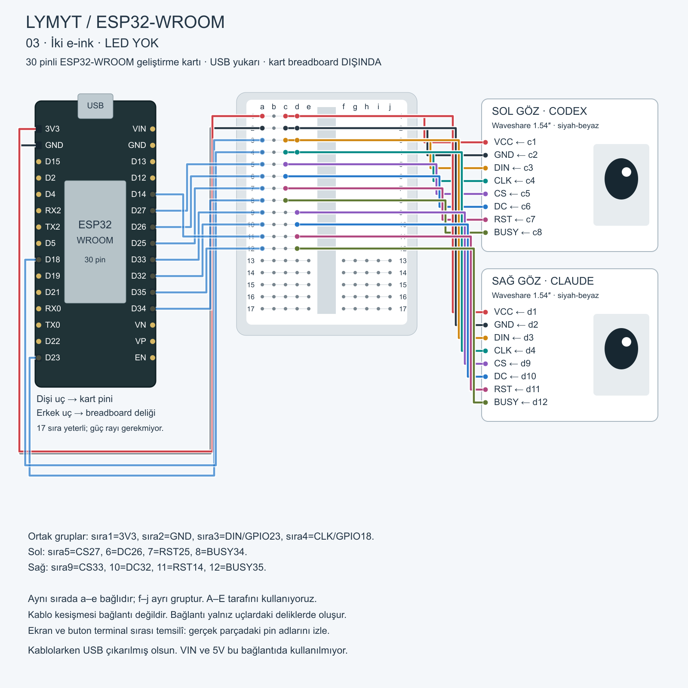

# Lymyt · ESP32-WROOM + iki e-ink · LED'siz

USB girişli, pinleri lehimli klasik ESP32-WROOM geliştirme kartı. Pin yerleri 13 Ekim 2026'da gönderilen 30 pinli kart fotoğrafından okundu: USB yukarı, sol üst 3V3/GND, sağ üst VIN/GND. S3/C3/C6 veya çıplak modül için kullanılmaz. Kart breadboard dışında yalıtkan yüzeyde kalır; dişi–erkek jumperlarla bağlanır. Harici LED, LED direnci ve sensör bu tasarımda yok. Düğme ilk aşamada bağlı değil.

[SVG'yi büyüt](wroom-epaper-full.svg) · [Besleme](wroom-breadboard-1.png) · [Tek göz](wroom-breadboard-2.png) · [İki göz](wroom-breadboard-3.png) · [İsteğe bağlı düğme](wroom-breadboard-4.png)

## Bir pin, iki ekran: dağıtım breadboard'da

ESP32'nin bir pinine yalnız bir dişi jumper tak. Erkek ucu a sütunundaki deliğe girer. Aynı sıradaki a–e delikleri içeriden bağlıdır; sol ekran c, sağ ekran d deliğinden aynı sinyali alır. Ortadaki yarık bu grubu f–j grubundan ayırır. Çizimde güç rayları kullanılmaz; mini breadboard'un ilk 17 sırası yeterlidir.

| Ortak hat | ESP32 → breadboard | Sol ekran | Sağ ekran |
|---|---|---|---|
| 3V3 besleme | 3V3 → a1 | VCC → c1 | VCC → d1 |
| Toprak | GND → a2 | GND → c2 | GND → d2 |
| SPI veri | D23 / GPIO23 → a3 | DIN → c3 | DIN → d3 |
| SPI saat | D18 / GPIO18 → a4 | CLK → c4 | CLK → d4 |

Örnek: a3, c3 ve d3 aynı içeride bağlı sıradadır. Böylece GPIO23'ün tek kablosu iki DIN kablosuna dağıtılır. Hatların kesiştiği yerler bağlantı değildir; yalnız çizimdeki delik uçları bağlantıdır.

## İki gözün bütün kabloları

| ESP32 pini | Karttan gelen kablo | Sol ekran kablosu | Sağ ekran kablosu |
|---|---|---|---|
| 3V3 | a1 | c1 → VCC | d1 → VCC |
| GND | a2 | c2 → GND | d2 → GND |
| D23 / GPIO23 | a3 | c3 → DIN | d3 → DIN |
| D18 / GPIO18 | a4 | c4 → CLK | d4 → CLK |
| D27 / GPIO27 | a5 | c5 → CS | — |
| D26 / GPIO26 | a6 | c6 → DC | — |
| D25 / GPIO25 | a7 | c7 → RST | — |
| D34 / GPIO34 | a8 | c8 → BUSY | — |
| D33 / GPIO33 | a9 | — | d9 → CS |
| D32 / GPIO32 | a10 | — | d10 → DC |
| D14 / GPIO14 | a11 | — | d11 → RST |
| D35 / GPIO35 | a12 | — | d12 → BUSY |

Karttan breadboard'a 12 kablo, ekranlardan breadboard'a 8+8 kablo: toplam 28 bağlantı. Ekranın kutusundan çıkan kablolar bu sayıya dahildir; uçların breadboard'a uygun erkek pin olması gerekir. Fotoğraftaki ESP32 pinlerine dişi uç takılır. Ekranın kablo rengi veya soket sırası için tahmin yapılmaz; üzerindeki VCC/GND/DIN/CLK/CS/DC/RST/BUSY yazısı izlenir.

## Kurulum ve test

1. USB'yi çıkar. Önce 3V3 → a1 ve GND → a2. VIN bu devrede boş. Kartın alt pinlerini metal yüzeye koyma.
2. Tabloya göre DIN/CLK ve kontrol kablolarını kur. CS/DC/RST/BUSY her ekran için ayrıdır. BUSY34/35 giriş pinleridir; bu hatlara çıkış sinyali gönderilmez. ESP32 GPIO'larına 5V uygulanmaz.
3. Arduino IDE: **esp32 by Espressif Systems**, genel klasik WROOM kartı için **ESP32 Dev Module**. Gerçek USB seri portunu seç. Gerekirse Ek Kart Yöneticisi URL'si: `https://espressif.github.io/arduino-esp32/package_esp32_index.json`.
4. GxEPD2, Adafruit GFX ve bağımlılıklarını kur. `firmware/PanelCheckWroom/PanelCheckWroom.ino` yükle. Yükleme Connecting'de takılırsa BOOT'a basılı tut; yazma başlayınca bırak.
5. Seri Monitör 115200: `s` pinleri raporlar, `l` sol göz, `r` sağ gözü test eder. İki ekran takılı kalabilir; test yazılımı diğer ekranın CS hattını seçilmemiş durumda tutar. Her ekranda LYMYT / LEFT veya RIGHT görünmeli. Aynı ekran testini üç dakikadan sık tekrarlama.
6. Beyaz kalırsa l/r testinin BEGIN/RESULT/BUSY çıktısını ve görünür sonucu incele. Rev2.1 taşıyıcı kart revizyonudur; kullanılan `GxEPD2_154_D67` panel sürücüsü henüz gerçek ekranda doğrulanmadı. Derlemenin geçmesi görüntünün çıktığını kanıtlamaz.
7. İki göz görüntü verdiğinde ana firmware: `config.wroom.example.h` → aynı klasörde `config.h`. Önceki Nano config.h dosyanın yedeğini al. USB true, OLED false, RIGHT_EYE_ENABLED true, LED_PIN -1, BUTTON_PIN -1; sensörler kapalı. ArduinoJson 7 ve U8g2_for_Adafruit_GFX de gerekli. Lymyt.ino ile BoardPins.h/Words.h/Learning.h birlikte kalır.
8. Yükle, Seri Monitör'ü kapat. Proje dizininden `python3 bridge/lymyt.py serve --serial-port GERCEK_PORT_ADI` çalıştır. WROOM portu Nano'nun eski usbmodem portuyla aynı olmayabilir. USB modunda Wi-Fi şifresi gerekmez. Claude girişinin yapılmış olması otomatik kota verisinin geldiğini kanıtlamaz; eksik/eski veriyi güncel kabul etme.

## İsteğe bağlı kelime düğmesi

İki ekran çalıştıktan sonra USB'yi çıkar. GPIO4 → a14; butonun basınca birleşen iki ayrı grubu b14 ve b2'ye bağla. Dört bacaklı butonda zaten bağlı olan grupları süreklilikle bul. `LYMYT_BUTTON_PIN 4` ile yeniden yükle. Harici LED gerekmez. Limit → kelime → öğrendim ve limit → sıradaki kelime. E-paper geçişi izin verilen yenileme zamanını bekler; ilerleme kartın kalıcı belleğinde tutulur.

## Doğrulama ve gövde

WROOM ana firmware ve PanelCheckWroom yazılımı Espressif Arduino core 2.0.17 / ESP32 Dev Module hedefiyle derlenir. GPIO planı ve breadboard delikleri birbiriyle kontrol edildi. İki e-ink'in bu kartta gerçek görüntü testi henüz yapılmadı. Önceki Nano gövdesinin USB konumu ve kart tutucusu WROOM'un gerçek ölçüsüne uyarlanmalı; LED açıklığı yeni gövde dosyalarından çıkarıldı. Breadboard prototipi gövdeye zorla sığdırılmaz.

Kaynaklar: [Espressif pinler ve besleme](https://docs.espressif.com/projects/esp-dev-kits/en/latest/esp32/esp32-devkitc/user_guide.html), [Arduino ESP32 kurulumu](https://docs.espressif.com/projects/arduino-esp32/en/latest/installing.html), [Waveshare ekran kılavuzu](https://www.waveshare.com/wiki/1.54inch_e-Paper_Module_Manual).
